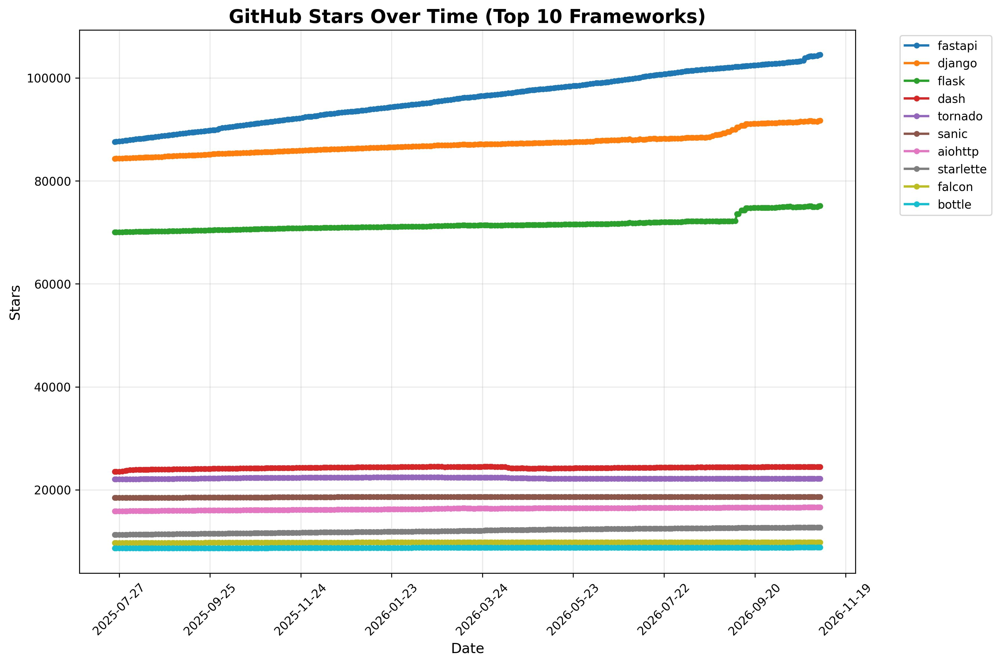
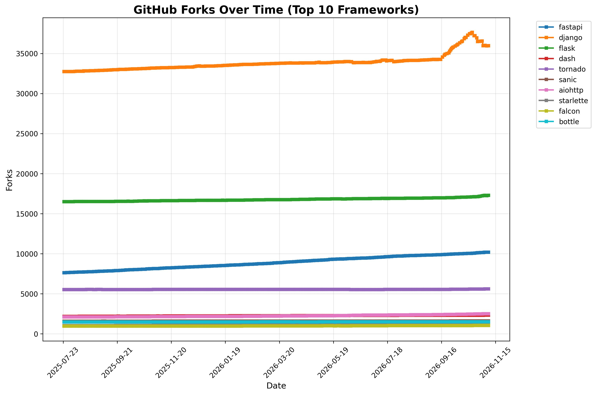

# Top Python Web Frameworks
A list of popular github projects related to Python web framework (ranked by stars automatically)

* UPDATE **list.txt** (via Pull Request)

## 📈 Current Rankings

| Project Name | Stars | Forks | Open Issues | Last Commit |
| ------------ | ----- | ----- | ----------- | ----------- |
| [fastapi](https://github.com/fastapi/fastapi) | 104531 | 10202 | 59 | 2026-11-05 08:55:58 |
| [django](https://github.com/django/django) | 91672 | 35967 | 535 | 2026-11-06 22:17:53 |
| [flask](https://github.com/pallets/flask) | 75056 | 17284 | 4 | 2026-10-30 15:05:20 |
| [dash](https://github.com/plotly/dash) | 24478 | 2341 | 447 | 2026-11-04 14:41:00 |
| [tornado](https://github.com/tornadoweb/tornado) | 22163 | 5606 | 223 | 2026-11-06 22:24:19 |
| [sanic](https://github.com/sanic-org/sanic) | 18629 | 1615 | 161 | 2026-05-31 19:29:09 |
| [aiohttp](https://github.com/aio-libs/aiohttp) | 16605 | 2510 | 302 | 2026-11-07 03:31:03 |
| [starlette](https://github.com/Kludex/starlette) | 12711 | 1435 | 32 | 2026-11-06 11:03:14 |
| [falcon](https://github.com/falconry/falcon) | 9813 | 1053 | 165 | 2026-11-04 21:49:13 |
| [bottle](https://github.com/bottlepy/bottle) | 8798 | 1515 | 289 | 2026-10-23 15:11:43 |
| [hug](https://github.com/hugapi/hug) | 6871 | 391 | 189 | 2023-06-30 13:14:01 |
| [eve](https://github.com/pyeve/eve) | 6750 | 737 | 30 | 2026-03-24 08:02:34 |
| [vibora](https://github.com/vibora-io/vibora) | 5580 | 300 | 140 | 2019-02-11 10:54:12 |
| [pyramid](https://github.com/Pylons/pyramid) | 4102 | 896 | 91 | 2026-08-04 21:13:49 |
| [quart](https://github.com/pallets/quart) | 3680 | 210 | 26 | 2026-09-12 09:07:19 |
| [masonite](https://github.com/MasoniteFramework/masonite) | 2356 | 136 | 1 | 2026-06-07 17:52:11 |
| [web2py](https://github.com/web2py/web2py) | 2167 | 915 | 356 | 2026-11-03 14:17:31 |
| [cherrypy](https://github.com/cherrypy/cherrypy) | 1949 | 371 | 279 | 2026-11-06 00:44:45 |
| [tg2](https://github.com/TurboGears/tg2) | 813 | 84 | 16 | 2026-10-12 21:07:19 |
| [Growler](https://github.com/pyGrowler/Growler) | 688 | 22 | 5 | 2020-03-08 07:51:41 |
| [morepath](https://github.com/morepath/morepath) | 395 | 40 | 78 | 2026-10-11 16:27:27 |
| [circuits](https://github.com/circuits/circuits) | 316 | 55 | 41 | 2026-10-05 23:20:26 |

## 📊 Growth Trends

### Stars Growth Over Time

### Forks Growth Over Time

*Charts show the top 10 frameworks by current star count*

*Last Automatic Update: 2026-11-07T04:54:47*