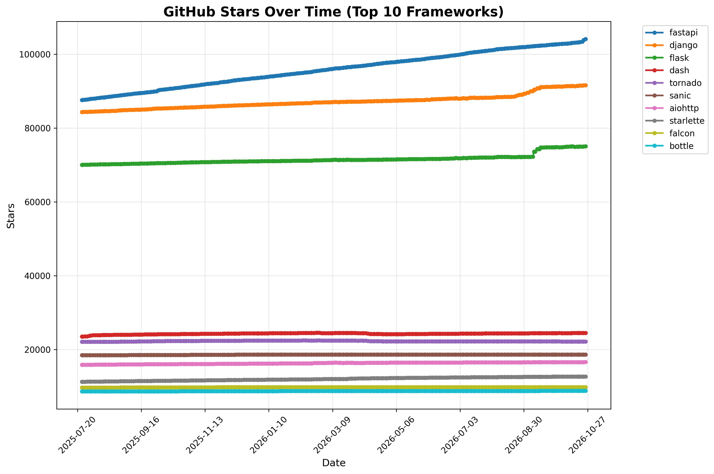
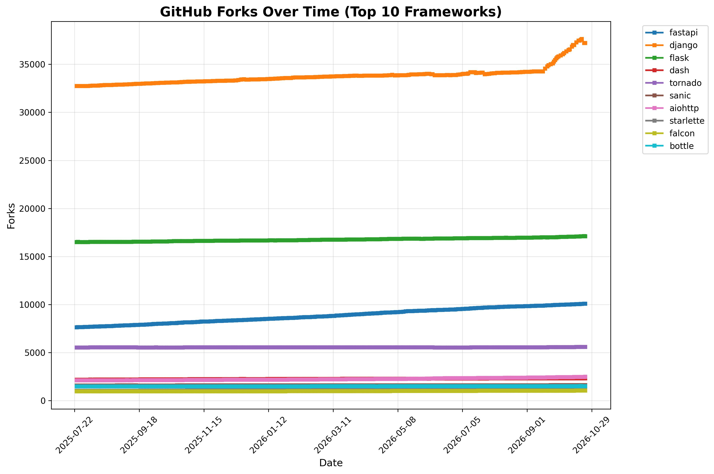

# Top Python Web Frameworks
A list of popular github projects related to Python web framework (ranked by stars automatically)

* UPDATE **list.txt** (via Pull Request)

## 📈 Current Rankings

| Project Name | Stars | Forks | Open Issues | Last Commit |
| ------------ | ----- | ----- | ----------- | ----------- |
| [fastapi](https://github.com/fastapi/fastapi) | 104266 | 10142 | 56 | 2026-10-26 10:29:12 |
| [django](https://github.com/django/django) | 91537 | 36540 | 534 | 2026-10-28 12:53:13 |
| [flask](https://github.com/pallets/flask) | 74937 | 17192 | 4 | 2026-10-07 14:02:54 |
| [dash](https://github.com/plotly/dash) | 24473 | 2331 | 433 | 2026-10-29 01:59:14 |
| [tornado](https://github.com/tornadoweb/tornado) | 22166 | 5592 | 234 | 2026-10-26 21:18:33 |
| [sanic](https://github.com/sanic-org/sanic) | 18631 | 1615 | 160 | 2026-05-31 19:29:09 |
| [aiohttp](https://github.com/aio-libs/aiohttp) | 16596 | 2493 | 264 | 2026-10-28 17:47:37 |
| [starlette](https://github.com/Kludex/starlette) | 12690 | 1419 | 53 | 2026-10-24 14:58:54 |
| [falcon](https://github.com/falconry/falcon) | 9811 | 1050 | 160 | 2026-10-24 19:47:09 |
| [bottle](https://github.com/bottlepy/bottle) | 8801 | 1516 | 288 | 2026-10-23 15:11:43 |
| [hug](https://github.com/hugapi/hug) | 6873 | 392 | 189 | 2023-06-30 13:14:01 |
| [eve](https://github.com/pyeve/eve) | 6750 | 737 | 30 | 2026-03-24 08:02:34 |
| [vibora](https://github.com/vibora-io/vibora) | 5583 | 300 | 140 | 2019-02-11 10:54:12 |
| [pyramid](https://github.com/Pylons/pyramid) | 4103 | 895 | 91 | 2026-08-04 21:13:49 |
| [quart](https://github.com/pallets/quart) | 3678 | 210 | 26 | 2026-09-12 09:07:19 |
| [masonite](https://github.com/MasoniteFramework/masonite) | 2356 | 135 | 1 | 2026-06-07 17:52:11 |
| [web2py](https://github.com/web2py/web2py) | 2167 | 917 | 355 | 2026-10-26 14:24:50 |
| [cherrypy](https://github.com/cherrypy/cherrypy) | 1946 | 370 | 278 | 2025-11-20 00:36:37 |
| [tg2](https://github.com/TurboGears/tg2) | 812 | 84 | 14 | 2026-10-12 21:07:19 |
| [Growler](https://github.com/pyGrowler/Growler) | 688 | 22 | 5 | 2020-03-08 07:51:41 |
| [morepath](https://github.com/morepath/morepath) | 395 | 40 | 78 | 2026-10-11 16:27:27 |
| [circuits](https://github.com/circuits/circuits) | 316 | 55 | 41 | 2026-10-05 23:20:26 |

## 📊 Growth Trends

### Stars Growth Over Time

### Forks Growth Over Time

*Charts show the top 10 frameworks by current star count*

*Last Automatic Update: 2026-10-29T04:41:06*