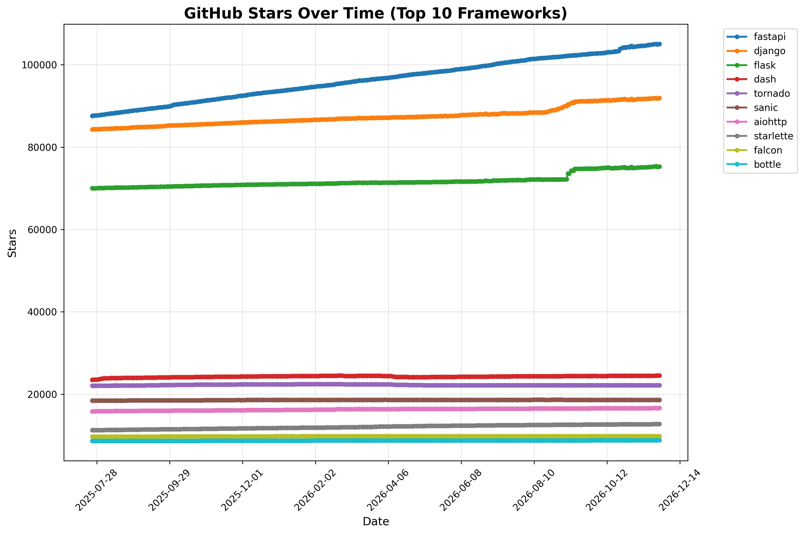
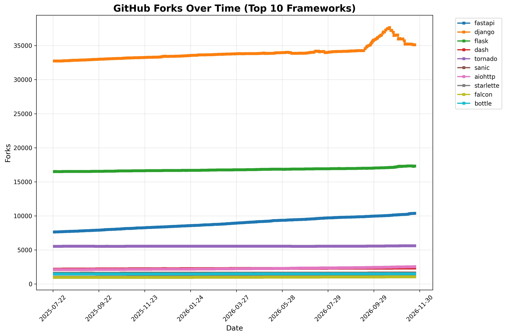

# Top Python Web Frameworks
A list of popular github projects related to Python web framework (ranked by stars automatically)

* UPDATE **list.txt** (via Pull Request)

## 📈 Current Rankings

| Project Name | Stars | Forks | Open Issues | Last Commit |
| ------------ | ----- | ----- | ----------- | ----------- |
| [fastapi](https://github.com/fastapi/fastapi) | 105047 | 10363 | 48 | 2026-11-18 19:13:45 |
| [django](https://github.com/django/django) | 91915 | 35058 | 539 | 2026-11-25 12:49:51 |
| [flask](https://github.com/pallets/flask) | 75287 | 17301 | 4 | 2026-10-30 15:05:20 |
| [dash](https://github.com/plotly/dash) | 24507 | 2350 | 421 | 2026-11-25 21:45:59 |
| [tornado](https://github.com/tornadoweb/tornado) | 22171 | 5619 | 171 | 2026-11-25 20:27:46 |
| [sanic](https://github.com/sanic-org/sanic) | 18638 | 1620 | 168 | 2026-05-31 19:29:09 |
| [aiohttp](https://github.com/aio-libs/aiohttp) | 16623 | 2545 | 338 | 2026-11-25 19:01:03 |
| [starlette](https://github.com/Kludex/starlette) | 12770 | 1461 | 37 | 2026-11-22 13:18:34 |
| [falcon](https://github.com/falconry/falcon) | 9823 | 1055 | 161 | 2026-11-25 07:07:00 |
| [bottle](https://github.com/bottlepy/bottle) | 8804 | 1512 | 289 | 2026-10-23 15:11:43 |
| [hug](https://github.com/hugapi/hug) | 6869 | 391 | 190 | 2023-06-30 13:14:01 |
| [eve](https://github.com/pyeve/eve) | 6748 | 737 | 30 | 2026-11-12 09:42:23 |
| [vibora](https://github.com/vibora-io/vibora) | 5576 | 301 | 140 | 2019-02-11 10:54:12 |
| [pyramid](https://github.com/Pylons/pyramid) | 4108 | 898 | 80 | 2026-11-25 00:49:13 |
| [quart](https://github.com/pallets/quart) | 3682 | 216 | 27 | 2026-09-12 09:07:19 |
| [masonite](https://github.com/MasoniteFramework/masonite) | 2353 | 136 | 1 | 2026-06-07 17:52:11 |
| [web2py](https://github.com/web2py/web2py) | 2165 | 913 | 356 | 2026-11-23 17:40:38 |
| [cherrypy](https://github.com/cherrypy/cherrypy) | 1949 | 373 | 280 | 2026-11-14 20:48:56 |
| [tg2](https://github.com/TurboGears/tg2) | 813 | 84 | 17 | 2026-10-12 21:07:19 |
| [Growler](https://github.com/pyGrowler/Growler) | 688 | 22 | 5 | 2020-03-08 07:51:41 |
| [morepath](https://github.com/morepath/morepath) | 394 | 41 | 78 | 2026-10-11 16:27:27 |
| [circuits](https://github.com/circuits/circuits) | 315 | 55 | 41 | 2026-10-05 23:20:26 |

## 📊 Growth Trends

### Stars Growth Over Time

### Forks Growth Over Time

*Charts show the top 10 frameworks by current star count*

*Last Automatic Update: 2026-11-26T07:05:39*